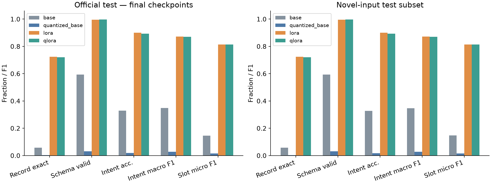
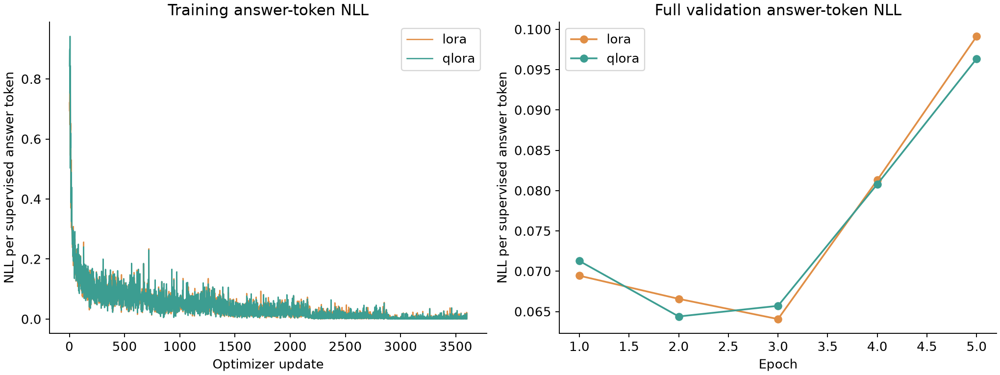
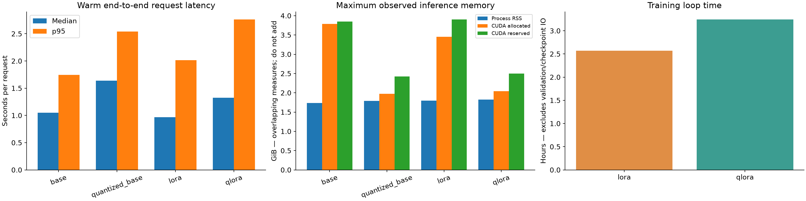
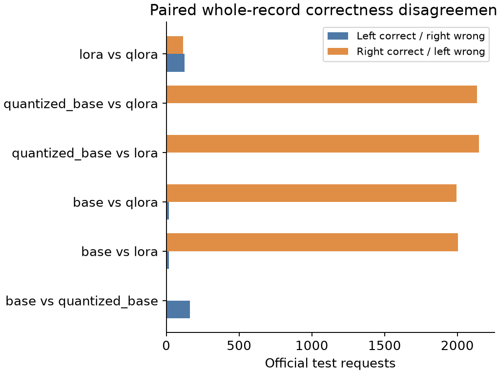

# LoRA versus NF4 QLoRA for structured request parsing

**Recorded experiment:** 30 September 2026 · `run_001` · one paired seed, 2027.

Both adaptations learned the requested JSON contract and substantially improved
whole-record accuracy on MASSIVE English. LoRA reached **72.46%** and QLoRA
**72.06%** on the same 2,974 test requests. QLoRA used less observed allocated
GPU memory but took longer in this two-A40 workload. Its training allocator
reservation was larger, so the evidence does not support an unqualified claim
that every measure of memory improved.

This report is a corrected publication view of saved evidence. It does not
replace the original run or claim that reporting fixes were used during training.
The [provenance manifest](publication_manifest.json), [configuration](config.json), and
[recorded environment](environment.json) identify the inputs to the analysis.

## Question and method

Under identical task data, initial adapters, and update/token budgets, how does
NF4 QLoRA affect strict structured-output correctness, observed memory, and runtime?

The comparison contains an unquantized base, an NF4 base, LoRA on the unquantized
base, and QLoRA on the NF4 base. All use Qwen2.5-1.5B-Instruct at immutable revision
`989aa7980e4cf806f80c7fef2b1adb7bc71aa306`. The unadapted systems expose behavior
before task-specific training; their scores are specific to this prompt and
strict output contract, not a general benchmark of language understanding.

The implementation follows the frozen-backbone, trainable low-rank update idea
from [Hu et al., LoRA](https://arxiv.org/abs/2106.09685). The quantized arm uses
NF4 and double quantization from [Dettmers et al., QLoRA](https://arxiv.org/abs/2305.14314),
with ordinary PyTorch AdamW instead of the paper's paged optimizer. This is a
controlled application of those methods, not a reproduction of either paper's
large-model results. Model architecture and upstream use instructions are in the
[official Qwen repository](https://huggingface.co/Qwen/Qwen2.5-1.5B-Instruct).

## Data and correctness contract

[MASSIVE](https://arxiv.org/abs/2204.08582) provides annotated assistant requests.
This run uses version 1.1, locale `en-US`, with the official 11,514 training,
2,033 validation, and 2,974 test examples. The source is the
[official dataset repository](https://github.com/alexa/massive).
Dataset-derived examples retain their CC BY 4.0 attribution; see
[third-party notices](../../NOTICE.md).

The model receives only the utterance and a fixed system instruction listing
the JSON contract and allowed labels. Gold annotations are absent from prompts.
For example, an output has this shape:

```json
{"intent":"alarm_set","slots":[{"type":"time","value":"seven am"}]}
```

Targets preserve slot values, case, punctuation, and repeated occurrences.
Annotation stripping must reconstruct the utterance. The primary metric requires
valid schema, correct intent, and an exact slot multiset; JSON key and slot order
do not matter. Prose, code fences, duplicate keys, unknown labels, extra fields,
and incorrect value types fail the strict contract. Invalid predictions stay in
the denominator. No repair, retry, or constrained decoding is used.

The [data audit](preparation/data.json) retains official splits and discloses
duplicates rather than silently removing them. A secondary test slice removes
26 requests whose normalized text occurs in training or validation, leaving
2,948 examples. Normalization uses NFKC, case folding, and collapsed whitespace;
it does not test semantic overlap or pretrained-model contamination.

## Training controls and execution

| Setting | Recorded value |
|---|---|
| Hardware | Two NVIDIA A40 GPUs, one worker per arm; concurrent execution |
| Runtime | Linux x86_64, Python 3.12.3, PyTorch 2.8.0+cu128 |
| Model libraries | Transformers 5.17.0, PEFT 0.21.0, bitsandbytes 0.50.2 |
| Precision | BF16 computation; FP32 adapters and optimizer state |
| Adapter | Rank 16, alpha 32, dropout 0.05; 18,464,768 trainable parameters |
| Targets | `q_proj`, `k_proj`, `v_proj`, `o_proj`, `gate_proj`, `up_proj`, `down_proj` |
| Optimization | AdamW, learning rate 2e-4, betas 0.9/0.999, epsilon 1e-8, weight decay 0 |
| Schedule | 3% warmup, cosine decay, gradient norm clipping at 1.0 |
| Batching | Microbatch 16 × accumulation 1; evaluation batch 32 |
| Budget per arm | Five epochs, 3,600 updates, 57,570 examples, 1,172,405 supervised tokens |
| Sequence / generation limit | 2,048 input-and-target tokens / 256 generated tokens |
| Decoding | Greedy, no sampling, no beam search |

Both arms load the same saved initial adapter and use identical example order
and accumulation boundaries. Only assistant-response tokens and EOS contribute
to loss. Prompt and padding labels are ignored; token-weighted updates retain
the final partial batch. Each epoch has 720 updates, including its last
10-example batch. There is no early stopping or model-quality hyperparameter search;
hardware pilots informed the batching used for the recorded run.

Non-reentrant gradient checkpointing and disabled training KV caching control
memory. QLoRA keeps its quantized base and unmerged adapter for evaluation.
Saving an adapter merged into a differently quantized base would change the system.

Full validation runs after every epoch. Best-validation selection uses record
accuracy, then lower answer-token NLL, then earlier epoch. The selected best
epochs are LoRA 5 and QLoRA 4; **both primary test results use final epoch 5**.
The [frozen protocol](evaluations/frozen_protocol.json) records the checkpoint
identities before test evaluation.

## Official test results

All percentages below use all 2,974 test examples. F1 values are expressed as
percentages; answer NLL is in nats per supervised token.

| System | Record exact | JSON valid | Schema valid | Intent accuracy | Intent macro-F1 | Slot micro-F1 | Answer NLL |
|---|---:|---:|---:|---:|---:|---:|---:|
| Base | 5.68% | 82.21% | 59.28% | 32.85% | 34.80% | 14.65% | 0.8251 |
| NF4 base | 0.27% | 7.46% | 3.19% | 1.82% | 2.72% | 1.54% | 1.0221 |
| LoRA | 72.46% | 99.97% | 99.56% | 89.95% | 87.14% | 81.30% | 0.1009 |
| QLoRA | 72.06% | 100.00% | 99.66% | 89.27% | 86.94% | 81.31% | 0.1031 |



LoRA succeeds on 2,155 records and QLoRA on 2,143: a 12-example, **0.403
percentage-point** difference. They both succeed on 2,028 examples; 127 are
LoRA-only successes, 115 QLoRA-only, and 704 fail both. This supports similar
observed task quality in this paired case study. It does not establish statistical
superiority, equivalence, or stability across training seeds.

On the 2,948-example novel-input slice, record accuracy is **72.39% LoRA** and
**72.01% QLoRA**. The close full/slice values show that this particular exact-text
overlap check does not account for most of the measured performance.

### Why the NF4 baseline looks unusually poor

**2,745 of 2,974 NF4-base responses (92.30%) begin with Markdown code fences**,
compared with 528 unquantized-base responses (17.75%). NF4-base outputs have
2,752 strict JSON failures in total. This explains most parse failures: a JSON
object inside a fence still violates the registered raw-JSON contract.

The primary scores remain unchanged. These observations diagnose format
compliance; they do not show that NF4 destroyed the model's semantic knowledge.
Inspect the [raw NF4-base predictions](evaluations/quantized_base/test/predictions.jsonl)
alongside the [unquantized predictions](evaluations/base/test/predictions.jsonl).

## Validation behavior

| Epoch | LoRA record exact | QLoRA record exact | LoRA answer NLL | QLoRA answer NLL |
|---|---:|---:|---:|---:|
| 1 | 66.45% | 65.81% | 0.06944 | 0.07127 |
| 2 | 68.42% | 68.86% | 0.06657 | 0.06439 |
| 3 | 70.88% | 70.19% | 0.06407 | 0.06571 |
| 4 | 71.57% | 72.26% | 0.08132 | 0.08080 |
| 5 | 71.82% | 72.21% | 0.09914 | 0.09636 |



Training loss falls while validation NLL rises in the last two epochs. Exact
accuracy continues to improve slightly or plateaus. This is a reason to discuss
confidence and possible overfitting, not proof of a causal mechanism or a reason
to replace the equal-budget final checkpoints after viewing the test results.

## Runtime and observed memory

| Arm | Optimization time | Whole-fit wall time | Training CUDA allocated | Training CUDA reserved |
|---|---:|---:|---:|---:|
| LoRA | 2.569 h | 3.107 h | 7.041 GiB | 11.973 GiB |
| QLoRA | 3.245 h | 3.937 h | 5.704 GiB | 20.146 GiB |

Optimization time covers synchronized update windows; whole-fit wall time also
includes loading/setup, validation, and checkpointing. These two arms ran
concurrently: their durations should not be added to estimate notebook elapsed
time. QLoRA took **26.29% longer in optimization**. Its observed allocated
training memory was **18.98% lower**, but reserved memory was **68.27% higher**.
Reserved memory describes allocator reservation, not an additional independent
pool to add to allocated memory or process RSS.

The inference benchmark uses the same seeded 100 validation requests, five
excluded warmups, three measured repetitions, and batch size one. Timing includes
tokenization, transfer, generation, and decoding with accelerator synchronization;
model loading and scoring are excluded.

| System | Median / p95 latency | Mean generated tokens/request | Generated tokens/s | Benchmark exact | CUDA allocated / reserved |
|---|---:|---:|---:|---:|---:|
| Base | 1.052 / 1.743 s | 44.68 | 38.74 | 2% | 3.785 / 3.846 GiB |
| NF4 base | 1.641 / 2.541 s | 48.81 | 27.62 | 0% | 1.976 / 2.426 GiB |
| LoRA | 0.966 / 2.016 s | 20.75 | 20.37 | 83% | 3.456 / 3.904 GiB |
| QLoRA | 1.323 / 2.763 s | 20.62 | 14.76 | 82% | 2.043 / 2.496 GiB |

Benchmark correctness describes its selected validation requests, not test-set
accuracy. The three repetitions repeat the same requests and do not create 300
independent examples. Output length and correctness belong beside speed: longer
incorrect base outputs can inflate generated-token throughput. QLoRA's warm
median latency was **36.88% higher** than LoRA's, with **40.89% lower observed
allocated memory** in this workload.



All memory figures are **maximum observed samples**, not guaranteed peaks.
Concurrent workers share CPU, RAM, and storage, so timing can include contention.
These measurements do not establish universal GPU or framework rankings.

### Correction to legacy sampling metadata

The original aggregation preserved maximum allocation values but overwrote
cumulative sample counts, elapsed time, error history, and swap totals with the
last segment. At the final checkpoint boundary that segment was almost empty,
giving misleading “2 samples / approximately 0.002 seconds” training metadata.

The publication view retains observed memory maxima and marks unrecoverable
cumulative metadata as **unavailable because of the legacy aggregation defect**.
It does not invent corrected historical totals or treat the last segment as the
whole training period. The original summaries remain intact. Current source
fixes aggregation for future runs and tests finalization and resume accounting;
these changes were not part of the recorded experiment.

## Representative errors

Examples below are the first failures by lexicographically sorted example ID,
rather than cases selected to favor one method. All utterances and gold records
are dataset-derived and subject to the attribution in [NOTICE](../../NOTICE.md).

- **Base, example `0`:** “wake me up at five am this week.” The model changes
  `five am` into `05:00`, invents `alarm_type=morning`, and misses `date=this week`.
  Semantic plausibility is insufficient when the contract requires exact fields.
- **NF4 base, example `0`:** emits a fenced JSON object, violating raw-JSON output;
  its slot assignment also differs from the reference.
- **Both adapted systems, example `100`:** “what's the week's forecast.” Both
  produce the correct `weather_query` intent but label `week's` as `date`; the
  reference uses `time`. The strict scorer correctly counts a missing and an
  extra slot. This illustrates dataset-annotation sensitivity rather than proving
  that the models lack a useful interpretation of the request.

Full-test failure counts include 337 missing-slot cases for LoRA and 334 for
QLoRA, and 298/319 wrong-intent cases respectively. On the novel slice those
counts can differ; they are not interchangeable. Failure categories overlap and
must not be summed into a number of failed requests.



## Inspect or reproduce

Reading this report, figures, and saved predictions requires no GPU or model
download. From the project root, the offline verifier can check the exported
hashes and rescore predictions using the standard library:

```python
from pathlib import Path
from src.publication import verify_publication

verification = verify_publication(Path("results/run_001"))
```

For another experiment, follow the [README](../../README.md) and the
[executed notebook](../../notebooks/lora_qlora.ipynb). Set the project path, install
requirements using the notebook's Python interpreter, inspect hardware, choose
the full or development configuration, and create a fresh run. The recorded
16/1/32 overrides are A40 settings; use hardware-derived defaults on smaller
devices. The notebook retains its original outputs and code; its updated
Markdown distinguishes historical execution from instructions for a new run.

The [original source snapshot](source_snapshot/manifest.json) is preserved
alongside the actual frozen configuration. Its notebook still contains unsaved
development defaults; the executed notebook and frozen configuration establish
the actual full experiment. Do not interpret the old notebook snapshot as the
effective run configuration. Current source includes post-run reporting fixes,
so resuming the original run requires its original source/environment and complete
local artifacts. The public evidence directory deliberately omits model weights,
checkpoints, and the full dataset; it is an audit package, not a resumable run.

## Limits and system implication

This is one seed, one English task, one model, one quantization recipe, and one
hardware/runtime combination. There is no seed-level uncertainty estimate or
registered non-inferiority margin. Duplicate filtering does not remove semantic
similarity or establish absence of pretrained exposure. Output-format sensitivity,
annotation conventions, differing response lengths, concurrent timing, and
sampled memory all constrain interpretation. Successful normal execution and
saved-model prediction do not themselves demonstrate an actual interrupted
full-model recovery, even though recovery has bounded implementation tests.

For this structured task, QLoRA is an available memory tradeoff, not an automatic
speed improvement. LoRA and QLoRA produced close observed record accuracy, and
both achieved much better contract compliance than their unadapted bases.
The appropriate implementation choice depends on the memory measure, throughput
requirements, and tolerance for errors in the application's exact output contract.
